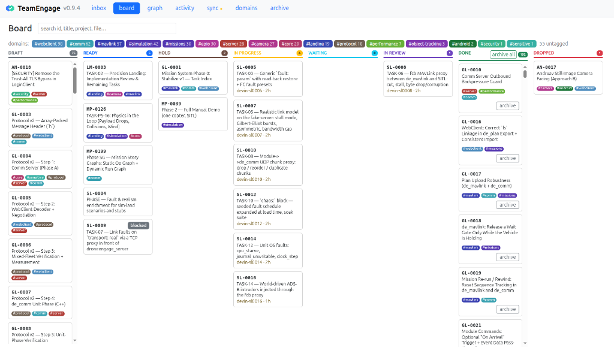
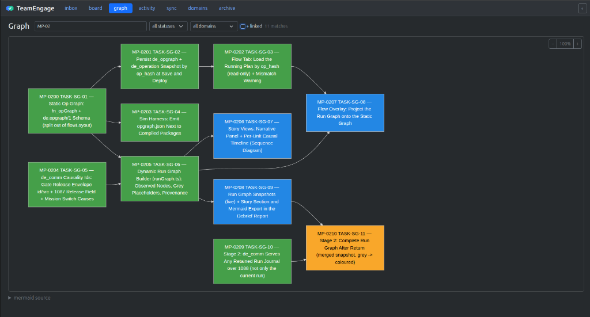
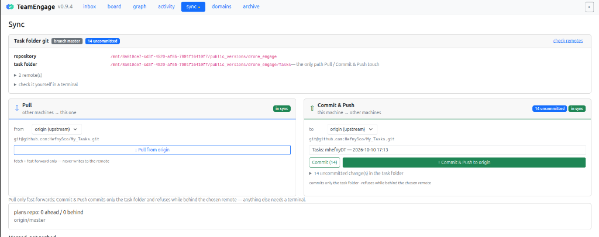

<p align="center"></p>

# TeamEngage

**A storyboard for one developer and their AI team.**

You plan the story; your AI agents — Claude Code, Devin, Gemini, Cursor,
on one machine or several — pick up the scenes, work them, and hand them back
for your review. TeamEngage is the board in between: everyone sees the same
plan, nobody takes the same task twice, nothing is "done" until you say so.

```
 you: plan · approve · answer · accept          agents: next → claim → log / ask → submit
            ╲                                                 ╱
             ╲──────────▶  TeamEngage board  ◀───────────────╱
                draft → ready → in progress → in review → done
```

| Board — every task, by status | Graph — dependencies as a diagram | Sync — git between machines |
|---|---|---|
|  |  |  |

### Your day with it

```bash
te approve TK-12 TK-13      # (or on the board) these tasks may be worked
te run                      # your coder agent implements, your reviewer checks;
                            # stops with "needs you: TK-13 asks …, TK-12 review ok"
te answer TK-13 "use port 5760"
te run                      # picks TK-13 up where it stopped
te accept TK-12             # merges its branch (under solo: auto 30m after an ok review)

te sync --leave             # leaving work: hand tasks over, push plans + code
te sync                     # at home: pull it all, then te run carries on
```

`te wait --notify` blocks until something needs you, so you can leave
`te run --watch` running and get pinged.

### Why it helps

- **Agents get fed, you get asked.** `te run` starts the agent CLIs you
  configured on each ready task, sends every submission to a reviewer model,
  and sends `issues` back for a fix. It only stops for you: questions,
  accepts, new plans.
- **Your task files stay yours.** It tracks an existing folder of Markdown
  task specs in place (one `te:` line per file).
- **No two agents on the same work.** An agent *claims* a task before it
  touches code. Claims lock the task's target paths and show up on every
  machine.
- **Nothing is done until you say so.** Agents *ask* instead of guessing and
  *submit* with evidence; you accept or reject.
- **Two machines, one workbench.** `te sync` carries the plans *and* the
  code (accepted merges, open task branches) between home and work, using
  your own git remotes. It only fast-forwards and never merges behind your
  back.

### Quick start

**Let your agent install it.** Paste this into Claude Code, Devin or any
coding agent:

> Install TeamEngage for me on this machine, following the solo fast path in
> https://github.com/HefnySco/teamengage/blob/master/AGENTS.md

Or by hand:

```bash
git clone https://github.com/HefnySco/teamengage.git ~/teamengage
cd ~/teamengage && npm run deploy                     # deps + build + `te` on PATH

te init --overlay --root ~/code/Tasks --prefix TK --repos '../*'   # track a task folder; sync the repos beside it
te import ~/code/Tasks --apply                        # tag the task files (dry run without --apply)
$EDITOR ~/.teamengage/machine.yaml                    # uncomment run: — your coder + reviewer CLIs
te run --dry-run                                      # what it would start
te ui                                                 # the board
```

Any `te` command starts the daemon. `npm run autorun` keeps it running
across logins (a systemd user service).

**Second machine:** make the task folder a git repo with a private remote
and push it. On the other machine, clone it and the code repos, run
`te init --overlay --root <same folder>`, then `te sync`. See
[team/README.md](team/README.md) for the agents.

**Setting it up on a machine, or asking an agent to?** Follow
[AGENTS.md](AGENTS.md) — step-by-step install, first/second machine, daemon
service, agent rules, skills, troubleshooting. Written for AI agents, readable
by humans.

More: [docs/DESIGN.md](docs/DESIGN.md) (concepts and state machine) ·
[docs/AGENTS-SETUP.md](docs/AGENTS-SETUP.md) (agent protocol) ·
[docs/TASK-FORMAT.md](docs/TASK-FORMAT.md) (task file format).

## Requirements

- Node.js >= 22
- git; rsync + ssh only for ssh/folder resources

## Develop

```sh
npm ci          # install
npm run build   # compile TypeScript to dist/ and bundle the web UI
npm test        # vitest
npm run lint    # eslint
npm run dev     # tsc --watch
```

## Layout

```
src/core        pure model: schema, parser, addressing, index, state machine,
                claims, validation, mermaid, event log
src/daemon      single-writer daemon: store, watcher, HTTP server, sessions,
                human API, SSE
src/mcp         MCP Streamable HTTP server, tools, stdio shim
src/cli         `te` commands
src/resources   git / ssh / folder / url resource drivers
src/daemon/sync te sync: plans repo + code repos between machines, claim reconciliation
src/import      importer for existing Markdown task folders
web/            human web UI, served by the daemon
skills/         agent skills: te-work (execute), te-review (peer review), te-plan (plan), te-tag (tag domains), te-analysis (triage)
team/           te run setup: coder + reviewer agent CLIs
```

Task files in overlay workspaces follow `docs/TASK-FORMAT.md` (`te template`).

## License

MIT — free to use, modify and redistribute, including commercially; just keep
the copyright notice. See [LICENSE](LICENSE).
