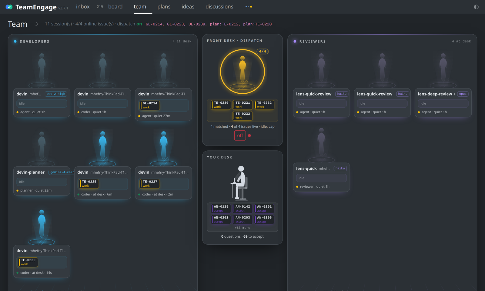
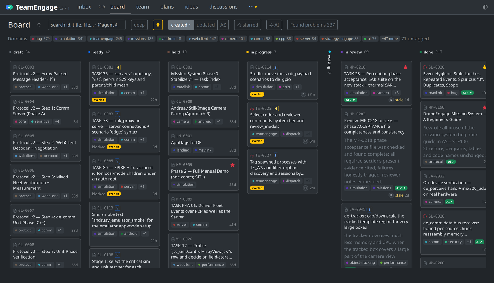
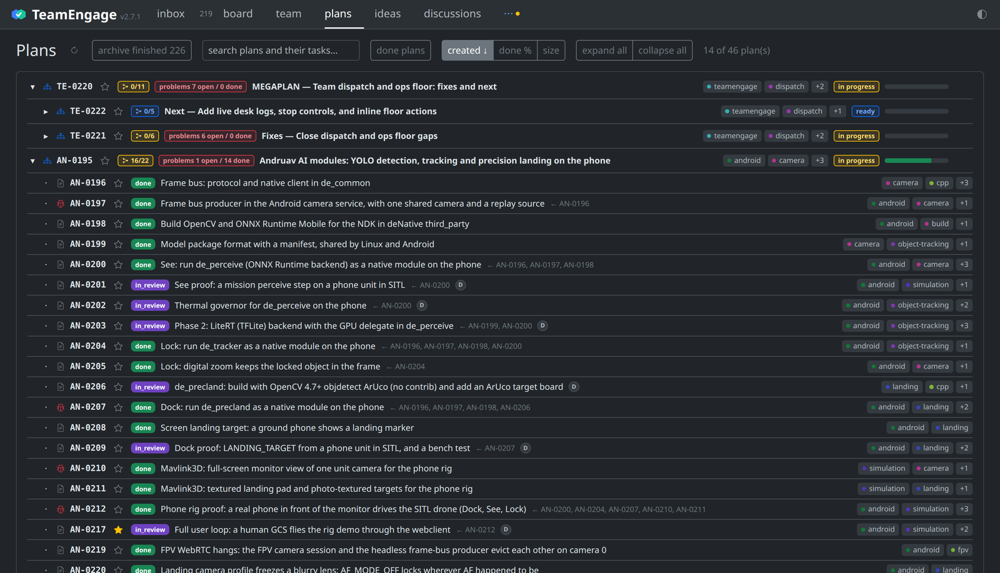
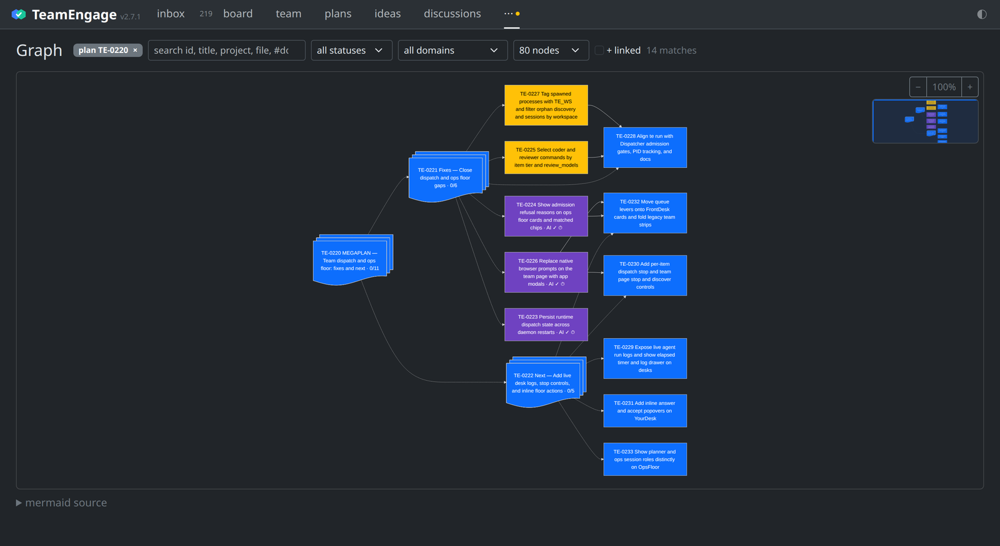
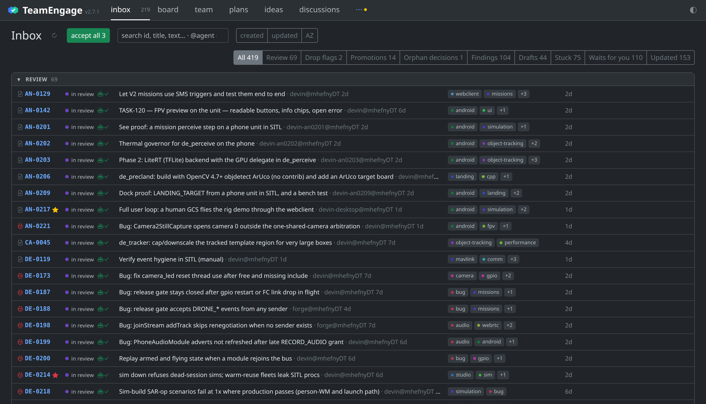
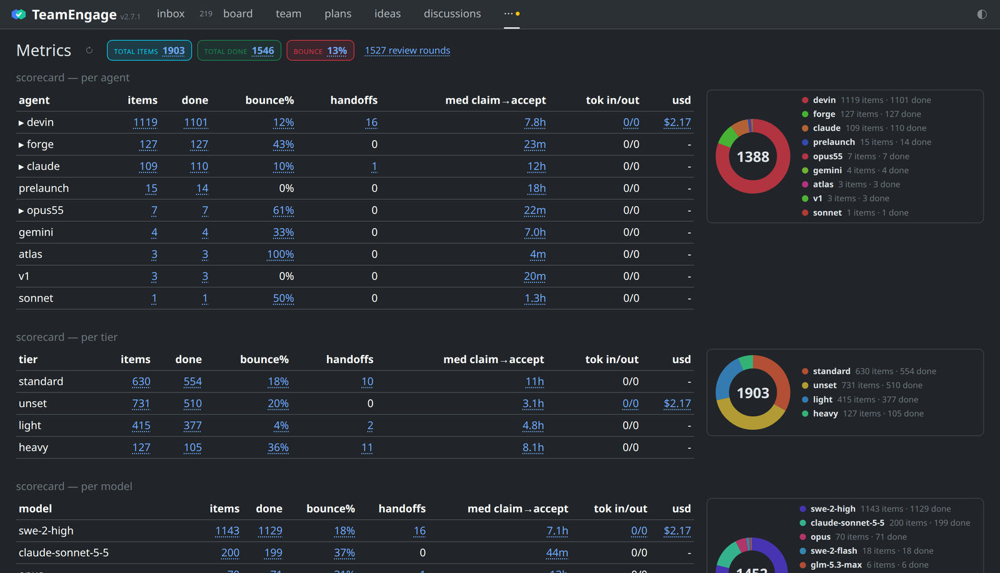
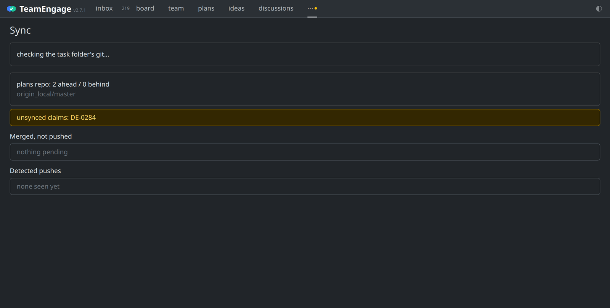

<p align="center"></p>

# TeamEngage

**A storyboard for one developer and their AI team.**

You plan the story; your AI agents — Claude Code, Devin, Gemini, Cursor,
on one machine or several — pick up the scenes, work them, and hand them back
for your review. TeamEngage is the board in between: everyone sees the same
plan, nobody takes the same task twice, nothing is "done" until you say so.

```
 you: plan · approve · answer · accept          agents: next → claim → log / ask → submit
            ╲                                                 ╱
             ╲──────────▶  TeamEngage board  ◀───────────────╱
                draft → ready → in progress → in review → done
```

<p align="center"></p>
<p align="center"><i>The ops floor: developers on the left, dispatch's capacity ring in the middle, reviewers on the right — every live agent as a hologram, with its task cards, an elapsed timer and a live log tail.</i></p>

| Board — every task, by status | Plans — epics & megaplans, progress % | Graph — dependencies as a diagram |
|---|---|---|
|  |  |  |
|  |  |  |
| *Inbox — questions, reviews, accepts waiting on you* | *Metrics — scorecard per agent, tier and model* | *Sync — plans & code between machines* |

### Your day with it

```bash
te approve TK-12 TK-13      # (or on the board) these tasks may be worked
te run                      # your coder agent implements, your reviewer checks;
                            # stops with "needs you: TK-13 asks …, TK-12 review ok"
te answer TK-13 "use port 5760"
te run                      # picks TK-13 up where it stopped
te accept TK-12             # merges its branch (under solo: auto 30m after an ok review)

te sync --leave             # leaving work: hand tasks over, push plans + code
te sync                     # at home: pull it all, then te run carries on
```

`te wait --notify` blocks until something needs you, so you can leave
`te run --watch` running and get pinged.

### Dispatch and the team page

`te run` runs in your terminal. **Dispatch** runs the same loop inside the
daemon, so agents keep working when no terminal is open. It is off until
you turn it on:

```bash
te dispatch on|off|status                  # start or stop the daemon's launcher
te dispatch pause [--kill] [reason]        # stop new picks; --kill also stops running agents
te dispatch push <ID>                      # queue one item past the filter, one-shot
te dispatch block <ID> [reason]            # keep one item away from agents
te dispatch stop <ID> [--release]          # stop one running agent, keep the rest
te dispatch unblock|unpush|reset <ID>
te discover                                # re-attach agents still running after a daemon restart
```

Dispatch honours a live limit (`max_issues`) and a selector filter
(`--filter`, for example `plan:TE-0212`). It refuses a pick when the item
has already failed twice, is blocked, or has no reviewer that differs from
the coder — and the team page shows the refusal reason on each card.
Dispatch state (on/off, limit, filter, pause, failures) survives daemon
restarts. A claim with no live holder is released automatically after
`auto_release_after` (default 2 h; `0` turns this off).

The web UI's **team** page (`/ui#/team`) shows the same state as a floor
plan: developers at their desks, the dispatch desk with its capacity ring,
the reviewers, and your own desk, where you answer questions and accept
work inline. Each running agent's card shows an elapsed timer and a live
tail of its run log; planner and ops sessions wear their own colours. The
page updates live over one shared event stream per browser.

### Why it helps

- **Agents get fed, you get asked.** `te run` starts the agent CLIs you
  configured on each ready task, sends every submission to a reviewer model,
  and sends `issues` back for a fix. It only stops for you: questions,
  accepts, new plans.
- **Watch them work.** The ops floor shows every live session at a desk —
  coder, reviewer, planner — with its task cards, an elapsed timer and a
  live log tail.
- **Your task files stay yours.** It tracks an existing folder of Markdown
  task specs in place (one `te:` line per file).
- **No two agents on the same work.** An agent *claims* a task before it
  touches code. Claims lock the task's target paths and show up on every
  machine.
- **Nothing is done until you say so.** Agents *ask* instead of guessing and
  *submit* with evidence; you accept or reject.
- **Two machines, one workbench.** `te sync` carries the plans *and* the
  code (accepted merges, open task branches) between home and work, using
  your own git remotes. It only fast-forwards and never merges behind your
  back. With `sync:auto`, the daemon also pushes plan commits as they happen.
- **Solo mode.** With `autonomy: solo`, an `ok` review is accepted
  automatically after `auto_accept_after` (30 min by default), unless an
  accept rule holds it back. Strict mode keeps every accept with you.
- **Playbooks for ops work.** `te ops` runs named playbooks with gates. An
  agent runs the steps and records evidence, and stops at each gate for you.
- **Searchable history.** `te search`, `te history`, `te digest` and
  `te metrics` answer what was done, what changed a file, and what got stuck.

### Quick start

**Let your agent install it.** Paste this into Claude Code, Devin or any
coding agent:

> Install TeamEngage for me on this machine, following the solo fast path in
> https://github.com/HefnySco/teamengage/blob/master/AGENTS.md

Or by hand:

```bash
git clone https://github.com/HefnySco/teamengage.git ~/teamengage
cd ~/teamengage && npm run deploy                     # deps + build + `te` on PATH

te init --overlay --root ~/code/Tasks --prefix TK --repos '../*'   # track a task folder; sync the repos beside it
te import ~/code/Tasks --apply                        # tag the task files (dry run without --apply)
$EDITOR ~/.teamengage/machine.yaml                    # uncomment run: — your coder + reviewer CLIs
te run --dry-run                                      # what it would start
te ui                                                 # the board
```

Any `te` command starts the daemon. `npm run autorun` keeps it running
across logins (a systemd user service).

**Second machine:** make the task folder a git repo with a private remote
and push it. On the other machine, clone it and the code repos, run
`te init --overlay --root <same folder>`, then `te sync`. See
[team/README.md](team/README.md) for the agents.

**Setting it up on a machine, or asking an agent to?** Follow
[AGENTS.md](AGENTS.md) — step-by-step install, first/second machine, daemon
service, agent rules, skills, troubleshooting. Written for AI agents, readable
by humans.

More: [docs/DESIGN.md](docs/DESIGN.md) (concepts and state machine) ·
[docs/AGENTS-SETUP.md](docs/AGENTS-SETUP.md) (agent protocol) ·
[docs/TASK-FORMAT.md](docs/TASK-FORMAT.md) (task file format).

## Requirements

- Node.js >= 22
- git; rsync + ssh only for ssh/folder resources

## Develop

```sh
npm ci          # install
npm run build   # compile TypeScript to dist/ and bundle the web UI
npm test        # vitest
npm run lint    # eslint
npm run dev     # tsc --watch
```

## Layout

```
src/core        pure model: schema, parser, addressing, index, state machine,
                claims, validation, mermaid, event log
src/daemon      single-writer daemon: store, watcher, HTTP server, sessions,
                human API, SSE
src/daemon/dispatch  the daemon's agent launcher: admission checks, caps, persisted state
src/daemon/sync te sync: plans repo + code repos between machines, claim reconciliation
src/mcp         MCP Streamable HTTP server, tools, stdio shim
src/cli         `te` commands
src/resources   git / ssh / folder / url resource drivers
src/import      importer for existing Markdown task folders
web/            human web UI, served by the daemon (board, graph, team page, ops floor)
skills/         agent skills: te-work (execute), te-review (peer review), te-plan (plan),
                te-tag (tag domains), te-analysis (triage), te-discuss (save chats),
                te-ops (run playbooks)
team/           te run setup: coder + reviewer agent CLIs
```

Task files in overlay workspaces follow `docs/TASK-FORMAT.md` (`te template`).

## License

MIT — free to use, modify and redistribute, including commercially; just keep
the copyright notice. See [LICENSE](LICENSE).
