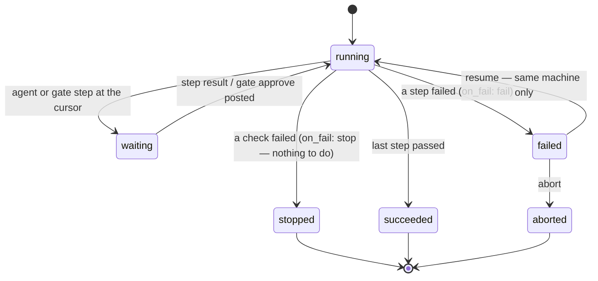

# TeamEngage — Design

> One human, many local LLM agents (Claude Code, Gemini CLI, Cursor, Devin,
> Windsurf, …) on one or more of the human's machines, planning and executing
> together on shared plans — concurrently, without corrupting each other's
> tasks or each other's code.

Status: **v0.4** (2026-10-16)

---

## 1. Problem

Today plans live in folders of Markdown (e.g. `~/de_code/Tasks`, ~450 files).
They are good _content_ but poor _coordination_:

- Status is implied by folder (`done/`, `partially-done/`), dependencies by prose
  (`**Depends on:** TASK-12`), IDs collide across folders.
- Nothing stops two agents from picking the same task, or two agents from
  editing the same repo/files at the same time — on the same machine or on
  two machines (desktop + laptop) that share plans through git.
- The human/agent loop is informal: agents guess instead of asking, claim
  "done" without evidence, and lose context between sessions, IDEs and machines.

Prior art solves pieces: **Backlog.md** (md+frontmatter tracker with MCP),
**Beads** (git-backed agent issue graph), **Task Master** (spec → task tree).
None is built around _multiple heterogeneous agents + one human_ working the
same plan concurrently. That is TeamEngage's reason to exist.

## 2. Principles

1. **Files are the truth.** Plans are Markdown + YAML frontmatter in a git repo.
   Readable and editable without the tool. The tool indexes; it never hides data.
2. **One writer per machine; machines converge through git.** A local daemon
   serializes every write on its machine. Agents never write plan files directly.
3. **Claims before work.** No agent touches an item, or code, without a claim.
4. **The human releases.** Claims don't silently expire; stale ones are flagged
   and the human decides.
5. **Evidence before done.** Agents _submit_; the human _accepts_.
6. **Ask, don't guess.** Ambiguity becomes a recorded question; the agent moves on.
7. **Never push for the human.** TeamEngage commits and merges locally; pushing
   is the human's call. Two exceptions: the human asking for a sync
   (`te sync`, or **sync now** / **Commit & Push** on the Sync page) — it
   fast-forwards and pushes the plans repo, then each code repo's base
   branch and open `te/*` task branches through their upstream remotes,
   refusing anything diverged, and agents can't reach it; and deploy
   commands, which run only from a playbook, by the `te ops` CLI, under
   that playbook's start policy (§14) — never ad hoc by an agent.
8. **Minimal agent output.** Tools return IDs and one-liners; detail on request.
9. **Small schema.** Add fields only when a real workflow needs them.

## 3. Concepts

| Concept                 | Meaning                                                                                                                                                                                                                           |
| ----------------------- | --------------------------------------------------------------------------------------------------------------------------------------------------------------------------------------------------------------------------------- |
| **Workspace**           | A root folder that is one plannable unit. `~/de_code` (many repos, one system) is one workspace; `~/code/foo` (a standalone project) is another. Registered per machine in `~/.teamengage/workspaces.yaml`.                       |
| **Plans repo**          | The git repo holding a workspace's plan files. Can be an existing repo (e.g. `~/de_code/Tasks`). It is what desktop and laptop sync through.                                                                                      |
| **Machine**             | A host running a daemon (`desktop`, `laptop`). Every claim, session and event records its machine.                                                                                                                                |
| **Resource**            | Anything work touches, declared in `workspace.yaml`, **inside or outside** the workspace root: a local git repo, a remote git URL, an SSH folder on another machine (e.g. a Raspberry Pi), a plain local folder, a URL. See §6.3. |
| **Project**             | Optional grouping inside a workspace (`mission_planner`, `andruav`) with its own ID prefix.                                                                                                                                       |
| **Item**                | Unit of plannable work. Types: `epic`, `task`, `bug`, `wish`, `spike`, `review`, `idea`, `discussion`. Lives at workspace level (cross-cutting) or project level (detail).                                                          |
| **Edge**                | `depends_on`, `parent`, `relates`. `blocks` is derived. Edges may cross projects and workspaces (§4.1).                                                                                                                           |
| **Turn**                | Whose move it is on an item: `human` or `agent`. Drives both inboxes.                                                                                                                                                             |
| **Claim**               | A session (agent **or human**) holding an item + its targets. Stored as a file in the plans repo so every machine sees it. No auto-expiry: inactive claims become **stale** and wait for the human.                               |
| **Evidence**            | Commits, test output, logs, snapshot diffs, notes, reported run cost (`cost:` line) attached on submit.                                                                                                                           |
| **Walkthrough**         | The submitter's explanation of the change — in STE (ASD-STE100 Simplified Technical English), required on submit, appended per submission.                                                                                        |
| **Question / Decision** | Agent asks → human answers → answer becomes a decision inherited by dependent items.                                                                                                                                              |
| **Session**             | A registered agent instance: `claude-code@laptop#a1f3`, `gemini-cli@desktop#77b0`.                                                                                                                                                |
| **Event**               | Append-only record of every change (who, where, what, when, why).                                                                                                                                                                 |
| **Playbook**            | A permanent ordered step list for repeatable operations — deploys, syncs. Lives in the plans repo, versioned with it (§14).                                                                                                       |
| **Job**                 | One execution of a playbook against a target: state machine, step results, deployed version (§14).                                                                                                                                |
| **Target**              | A deploy slot declared in `workspace.yaml` — a host, a service, an environment (§14).                                                                                                                                             |

## 4. On-disk layout

```
~/.teamengage/                     # per machine, never synced
  machine.yaml                     # machine name (desktop / laptop)
  workspaces.yaml                  # registry: name → root path
  daemon.json                      # pid, port, token (written by daemon)
  clones/                          # managed clones of remote-git resources
  snapshots/                       # pre-claim snapshots of ssh/folder targets

~/de_code/                         # a workspace root
  .teamengage/  (or plans: ~/de_code/Tasks)   # the plans repo — synced via git
    workspace.yaml                 # name, prefixes, projects, resources, links
    items/
      DE/DE-0003.md                # workspace-level item (cross-cutting epic)
      MP/MP-0042.md                # project-level item
      GL/GL-0013.md
    claims/GL-0013.yaml            # one file per live claim (§6.5)
    decisions/D-0007.md
    events/desktop/2026-10.jsonl   # append-only, one stream per machine
    events/laptop/2026-10.jsonl    #   → never a git merge conflict
    lessons/simulation.md          # shared lessons per domain (GL-0322)
    .gitignore                     # worktrees/, local state
    worktrees/                     # agent worktrees, machine-local
  droneengage_mavlink/             # repos, untouched by TeamEngage except via worktrees
  droneengage_comm/
```

### workspace.yaml

```yaml
name: droneengage
prefix: DE # workspace-level items: DE-0001…
plans: Tasks # plans repo path (default: .teamengage)
sync: manual # manual | auto  (§6.5)
stale_after: 24h # inactive agent claim → flagged stale
session_idle_after: 2h # session with no pid, silent this long → not live (its claims go dead)
autonomy: strict # strict | solo  (§5 — solo: fewer human gates)
auto_accept_after: 30m # solo: ok peer review → daemon accepts after this
auto_accept_rules: # solo: ordered rules; first match sets the item's delay
  - { tier: light, after: 5m } #   conditions (all must match): tier, project, domains
  - { domains: [meta], after: never } #   never = the accept stays the human's
auto_archive_after: 7d # unset = off: daemon archives items done/dropped longer than this (§5)
auto_release_after: 24h # unset = off: daemon releases dead-session claims stale longer than this (§5)
peer_answer_after: 30m # a peer question unanswered this long becomes the human's (§5)
dispatch: # unset = off: the daemon starts agent commands when work exists (§5)
  enabled: false            # the human turns it on: te dispatch on (agents get FORBIDDEN)
  max_sessions: 2           # live agent sessions on this machine the daemon fills up to
  agents:                   # one command per role; ran in the workspace root
    - { role: coder, command: "devin -p --model swe-2-high --" }
    - { role: reviewer, tier: standard, command: "claude -p \"$TE_PROMPT\"" }
notify: # unset = off: alert the human on decision events (§5)
  - { on: question, command: "./scripts/ping.sh" } # runs with the event JSON on stdin
  - { on: needs_human, url: "https://example/hook" } # or POSTs the JSON
  # on: question | needs_human | max_attempts | ops_gate | digest
agent_kinds: # scorecard grouping (§8 metrics): kind → globs on the agent
  devin: ["devin*"] # name, lowercase, first match wins; no match → the
  forge: ["forge*", "devin-forge-*"] # name's text before its first - or _
agent_models: # model scorecard fallback (§8 metrics): model → globs on the
  swe-2-high: ["devin*"] # agent name, same rules; used only when the event
  haiku: ["lens-quick*"] # carries no declared model (pre-GL-0360 history)
projects:
  mission_planner: { prefix: MP }
  global: { prefix: GL }
  andruav: { prefix: AN }
resources:
  mavlink: { kind: git, path: droneengage_mavlink, base: master }
  comm: { kind: git, path: droneengage_comm, base: master }
  andruav: { kind: git, path: ~/AndroidStudioProjects/andruav, base: main } # outside root
  sdk: { kind: git, url: git@github.com:HefnySco/de_sdk.git, base: main } # pull-only
  rpi-field: { kind: ssh, host: pi@rpi4.local, path: /home/pi/drone_engage, snapshot: true }
  docs: { kind: folder, path: ~/Documents/de_specs }
  wiki: { kind: url, url: https://cloud.ardupilot.org/ }
links: # other workspaces this one may reference
  mcp: ~/code/mcp
```

Paths are per machine: if the laptop keeps a repo elsewhere, `~/.teamengage/workspaces.yaml`
on the laptop may override any resource `path`.

### 4.1 Addressing objects

Every object has a stable address; references are flexible:

| Reference                                 | Resolves to                                                    |
| ----------------------------------------- | -------------------------------------------------------------- |
| `MP-0042`                                 | item in the current workspace (prefix is unique per workspace) |
| `mcp:SL-0007`                             | item in linked workspace `mcp`                                 |
| `@mavlink`                                | resource                                                       |
| `@mavlink:src/mission/**`                 | path(s) inside a resource                                      |
| `@rpi-field:/home/pi/drone_engage/config` | path on the Pi                                                 |
| `D-0007`                                  | decision                                                       |

So a workspace-level epic `DE-0003` ("Protocol v2") can parent
project tasks `GL-0002`, `MP-0110`, `AN-0009`, and depend on an item in
another workspace — all one graph.

### Item file

```markdown
---
id: GL-0013
type: task
title: Mission re-run resets sequence tracking
status: in_progress # see §5
project: global
targets: ["@mavlink:src/mission/**", "@comm:src/**", "@rpi-field:config/**"]
depends_on: [GL-0012]
parent: DE-0003 # workspace-level epic
priority: 2
version: 7 # bumped by daemon on every write (CAS)
created: 2026-09-20
updated: 2026-10-08
---

## Summary

...technical description for agents...

## Simple

...STE version for the human (replaces *.simple.md)...

## Acceptance

- [ ] second AUTO run fires module commands
- [ ] SITL rerun test passes

## Log

<!-- daemon-appended, newest last -->

- 2026-10-08T09:12Z claude-code@desktop#a1f3 claimed
```

`turn` and `blocked` are derived, not stored. The claim itself lives in
`claims/GL-0013.yaml`, so claiming never edits the item file.

### Discussions (TE-0155)

A **discussion** is a saved chat — a source document like an idea. It is
never claimed and never worked; tasks plan from it through `relates`
(reference only — no ordering, no gate). It has two layers:

- `DISC-NN-<slug>.md` — the **distilled** layer: fixed sections
  (`## Summary`, `## Participants`, `## Context`, `## Key points`,
  `## Decisions reached`, `## Open questions`, `## Guidelines`,
  `## Actions`, `## Artifacts`, `## Notes`). This is what `search` and
  `brief` read.
- `DISC-NN-<slug>.transcript.md` — the **raw** layer: the whole chat,
  linked under `## Artifacts` and committed with the plans repo. Import
  skips it; the default search skips it; `search in=transcript` reads
  it, and `brief <id> more=transcript page=N` pages it ~200 lines at a
  time.

A discussion's state is **derived**, not stored — the same rule as an
idea: its own `draft`/`dropped`/`done` status wins outright, `done` when
every live referrer (an item that names it in `relates`) is done, `ready`
otherwise. A source document never tracks planning or progress; the
related count covers that signal.

**Capture** (`capture`, `POST /api/discussions`, `te discuss save`) takes
the distilled sections plus the transcript as text or a file; a Claude
Code JSONL export converts to Markdown turns (user / assistant / tool
calls in short form). Before the write the transcript is **secret-scanned**
(API keys, tokens, passwords, private keys, JWTs): a hit refuses the call
and names the lines, unless `redact: true` masks each with `[REDACTED]` or
`sensitive: true` keeps it and tags the artifact `!sensitive`.
`discussions.transcript_max_mb` (default 20) caps the size, and the reply
always warns that the transcript enters the plans git repo.

**Retrieval:** `query type=discussion` lists them; `search` covers the
distilled sections (add `in:transcript` for the raw layer); `brief <id>`
shows the distilled sections, participants, related items and the
transcript size in under ~120 lines.

**Promote** turns a `## Guidelines` or `## Decisions reached` line into a
project record — with a human gate. `promote {id, section, line, to:
lesson|decision, domain?}` records a pending candidate on the discussion
(the inbox and the web board list it) and links it in `## Actions`. Only
when the human approves does anything land: a lesson line in
`lessons/<domain>.md` that names the discussion, or a `D-NNNN` record
whose `item:` is the discussion. A rejection writes nothing; either way
`## Actions` links the result, so the provenance stays visible.

## 5. State machine

```
draft ──approve_plan──▶ ready ──claim──▶ in_progress ──submit──▶ in_review ──accept──▶ done
  ▲                       ▲                │    │                    │
  │                       │                │    └─ask──▶ waiting ────┘ │
  └──────── reject ───────┼──── release ◀──┘                           │
                          └───────────────── release ◀─────────────────┘
hold     = human only; draft|ready ──hold──▶ hold ──unhold──▶ ready
                       ready|hold|done ──to_draft──▶ draft
review  = agent only, in_review, never the holder, never the submitter's
          model (a session without a declared model falls back to its
          agent name): records a verdict on the submission (ai_review).
          `ok` is advisory — status untouched. `issues` is the one
          send-back path: a holder live on this machine keeps the claim
          and fixes ──▶ in_progress; a dead or outgrown holder's claim
          ──▶ ready, branch kept; a holder on another machine keeps its
          claim and the item stays in_review for it. Capped at 2 issues
          verdicts in a row — then the item stays in review for the human.

workspace.yaml review_models = {deep, quick, deep_from_tier (default
          heavy)}: when set, review also requires the reviewer to
          declare a model, items at or above deep_from_tier need the deep
          model, lower items the quick or deep model; next filters the
          reviewer pool the same way; te validate warns on unset models
          Auto-accept and batch accept also apply the rule: an ok review
          without a compliant reviewer_model never arms the delay — the
          item waits for the human and says so
withdraw = holder only, in_review ──▶ in_progress, claim kept: the
          submitter pulls its submission back to keep working before the
          human looks at it
takeover = claim on in_review carrying an `issues` verdict: any agent
          session on the claim's machine takes claim and worktree over
          ──▶ in_progress (cross-machine refused — worktrees are
          machine-local, §6.3). The same takeover applies to an
          in_progress item whose holder can't act from this daemon (dead
          session): the new session takes claim, worktree and branch over
          and continues where it stopped — a dead holder must not strand
          the work. A live holder's in_progress claim stays untouchable.
reject   = human only: in_review ──▶ in_progress, claim kept — the holder
          fixes and resubmits. `te reject <ID> --release` instead sends it
          ──▶ ready: the claim is released, branches kept (dirty work is
          WIP-committed first), so another agent's claim resumes the same
          work. On ready, reject un-approves ──▶ draft.
release  = in_progress|waiting ──▶ ready as before; on in_review it also
          means "submission back to the pool": claim dropped, branches
          kept. The holder may release its own claim anywhere; an agent
          session may release someone else's in_review claim only on the
          claim's machine and must say why (note required, recorded under
          ## Review). Releasing another machine's claim stays human-only.
blocked  = derived: any depends_on not done (in_review counts as done
           unless workspace.yaml review_unblocks: false)
dropped  = human only; ──undrop──▶ draft (re-approval required)
flag_drop= agent only, any non-terminal status: advisory `drop_request`
          (by / reason / at) — the human's `drop` approves, `unflag_drop`
          keeps it; status and claims are untouched meanwhile
ask to:peer = holder only: the question is recorded on the item but the
          item stays `in_progress` — peers answer first (below). A second
          ask while a question is open is refused.
answer_peer = another session's job: never the asker, and an agent must be
          the asker's tier or higher. The answer lands in ## Notes and in
          `meta.peer_answer` (the holder sees it in brief); the item stays
          `in_progress`. The human may answer a peer question the same way.
peer_timeout= daemon sweep: a peer question unanswered longer than
          `peer_answer_after` becomes a normal human question ──▶ waiting
          (the `notify` kind `question` covers it).
change_answer = human only, any status but done/dropped: revise the item's latest answer
           (same decision id, version +1, old → new in the Log)
done     = terminal, but ──to_draft──▶ draft reopens it (done-by-mistake;
           the item goes through approve → claim again)
```

- `turn`: `draft`, `hold`, `in_review`, `waiting` → **human**; `ready`, `in_progress` → **agent**.
- `review_unblocks` (default `true`): a dependency that is submitted
  (`in_review`) unblocks its dependents, so approved work can go on in
  sequence without waiting for each acceptance. `brief` marks such a
  dependency "not accepted yet"; if it is rejected while a dependent is
  started, the inbox shows a `started_on_open_dep` warning. Set `false` to
  require `done`.
- Per task, `unblocks_on` overrides that for the task's dependents:
  `done` makes it a **key task** (🔑 — dependents wait for its acceptance;
  `te key <ID>`, the toggle on the item page), `review` lets them start at
  review even in a strict workspace; unset follows the workspace.
- `hold` parks an item: it is not a draft (the plan is fine), but not for
  agents yet — `next` skips it and `claim` refuses it. `te hold` / `te unhold`
  / `te draft`, or hold / resume / to draft in the UI. A claimed item must be
  released before it can be held — except `in_review`, where hold parks the
  review and frees the claim (the branches stay, TE-0176).
- `archived` is a **tag, not a status** (`te archive` / `te unarchive`, the
  Archive page in the UI). The item keeps its real status, so dependency
  chains still resolve (an archived `done` dep is still done) and agents see
  it tagged `[archived]` in `brief`. Archived items leave the board, inbox,
  graph, `query` and `next`, and cannot be claimed. Claimed items must be
  released first.
- `star_color` is the human's **bookmark** (`te star <ID>
[yellow|red|green|blue]` / `te unstar`, ★ on board cards and the item
  page — clicking flips none → yellow → red → green → blue → none). A pure
  marker with no workflow effect: it works in any status — even while
  claimed — hides nothing, and never feeds `next` ordering (that stays
  `priority`-driven).
- `ai_review` is the latest **AI peer review** of the current submission —
  written by `review` from an agent session that is _not_ the
  holder (a self-review would only manufacture a trust marker): verdict
  `ok|issues`, reviewer session, date, note. An `ok` is a triage hint for
  the human's review queue (badge on board cards, marker in the inbox,
  banner on the item page); `issues` sends the submission back (§5).
  `accept`/`reject` stay human-only and the turn stays the human's.
  Anything the human must decide on carries
  `ask_human` — the short decision card (GL-0344): `problem` ≤40 words,
  `recommendation` ≤30 words, optional 2–3 `options` of ≤4 words each. A
  `needs_human` review and an `issues` verdict require it;
  a plain `ok` needs only `summary` ≤25 words. `ask` takes an optional
  `context` for the detail — the question text stays ≤40 words; `note`,
  `report` and `findings` stay the agent layer with no limit.
  The review card shows `problem` and `recommendation` as text (TE-0176):
  its buttons are fixed actions — **Accept**, **Send back to coder**
  (the `review` issues verdict with the human as actor: a live local
  holder keeps the claim and fixes, a dead or outgrown holder's claim
  goes to `ready` with the branch kept, a holder on another machine is
  untouched, never capped and never `needs_human`), **Create follow-up
  task** (propose with `found_by` set) and **Hold**. Picks are no longer
  recorded as D-records — decisions come only from `answer` (an agent
  `ask`) and from promoted decision lines on discussions. Existing
  review-card picks list at `GET /api/decisions/review-card-picks`
  (read-only) and are excluded from `domain_decisions`.
  `submit` clears it (a fresh submission starts
  unreviewed).
- `findings` is the latest review's **structured checklist** (GL-0321):
  `review` may carry `findings: [{text, where?, severity:
  must|should}]`, stored on the item and shown on the item page above the
  folded report. The holder answers on the next `submit` with
  `finding_states: [{finding: <1-based>, state: done|skipped, reason?}]` —
  an unanswered `must` refuses the submit (INVALID_TRANSITION). The states
  write back onto the checklist and into `## Review`; a review without
  findings clears the list (it was already answered). Old reviews with
  only text show as before.
- An **idea** is a **source document**, not work: a thought, brainstorm or
  spec the human (or an agent, via `propose type:"idea"`) captured for
  later planning. `claim` refuses it ("ideas are sources — plan from them")
  and `next` skips it — the same treatment epics get. Its lifecycle is the
  normal one minus execution: `draft` → `ready` is an optional "triaged"
  marker, never a gate — an agent may plan from an idea in any status;
  `complete`/`drop`/`archive` close it out. The link back is `relates`:
  items generated from the idea name it in `relates` (reference only — no
  ordering, no gate), and the idea's page lists its referrers under
  "referenced by". `te relate <ID> [refs|--off]` edits the edge, like `te deps`.
  Ideas live on their own page (`#/ideas`), never in the inbox or on the
  board: each row folds open to the plans and tasks that name it.
  `idea_state` is **derived, never stored**: `dropped` first, then `done`
  — the stored verdict, or every live referrer done (≥1 referrer) — then
  `draft`, otherwise `ready`: done beats draft, so a draft source whose
  tasks all finished shows done. Ideas never track `in_progress`, they
  are sources. A referrer that is an epic counts through its leaf tasks
  — naming the plan in `relates` is enough; a dropped plan's leaves
  count nothing. On its sweep the daemon marks such a source's stored
  status `done` (`source_auto_done`, like `plan_auto_done` for epics —
  §5), so the archive sweep and the UI treat it as finished. `idea_refs`
  holds the referrer ids and `idea_progress` the done/total over live
  referrers (dropped ones do not count); archived referrers count as
  hidden.
- A **plan** is an epic; its parts are the items whose `parent` points at
  it (sub-plans are epics too, so it nests). `plan_state` is **derived,
  never stored** — the children alone decide it: `dropped` when the human
  drops it, `draft` with no children or every child still a draft,
  `in_progress` while any part is in flight (claimed, waiting or in
  review — the plan itself belongs to no machine, its parts may run on
  different ones), `done` when the stored status says so — a hand or
  auto-done verdict — or when every descendant is done/dropped and no
  problem under the plan is still open (a sub-plan marked done counts as
  done for its parent; parent cycles count as not done), `ready`
  otherwise. In-flight parts beat a stored done: a reopened part drags
  the plan back to `in_progress`. Each part's own `draft` status is the
  only gate — approving the epic approves its draft children in the same
  click (one event per child), and a ready part under a draft plan is
  claimable as usual. `plan_progress` is finished/total over
  non-epic descendants; archived parts still count. Epics are plans, not
  work — `next` skips them and `claim` answers "epics are plans — claim
  their tasks". A plan in `done` state whose status is not yet `done` gets
  `plan_auto_done` on the daemon sweep — stored status catches up with the
  derived state and moves forward only, so parts added later show the plan
  `ready` again until the human re-drafts the epic.
- **Delete** (`te delete <ID> --yes`, delete in the UI) removes an item from
  TeamEngage, not from disk: the tracking file goes, the event log keeps a
  `delete` record, and in overlay mode the task file stays as plain Markdown
  (its `te:` line removed, its path added to `ignore:`). Deleting the file
  itself is the human's own git operation. Refused while claimed or while
  another item depends on it or names it as parent. Milder options first:
  drop (decided against, still listed) and archive (hidden, restorable).
- `drop_request` is the agent's **delete flag** (`flag_drop` tool, any tier,
  any non-terminal status — claimed or not): advisory only. The item keeps
  its status and claim until the human drops it (the claim is released and
  work cleaned up, as always) or keeps it (`te unflag` / "keep" in the
  inbox, `unflag_drop`). The flag carries the flagger and its reason so the
  human sees who asked and why.
- **A draft is fully editable** — the agent `edit` tool (planner tiers:
  standard/heavy) rewrites any field of a draft: title, summary, acceptance
  (the whole checklist is replaced), touches, depends_on, parent, targets,
  tier, domains and non-managed `##` sections (Notes/Review/Evidence/
  Walkthrough/Handoff/Log/History are refused). The item stays a draft, so the human's
  approve remains the gate — every edit is by definition pre-approval. For
  anything non-draft the human's `to_draft` is the go-ahead to rescope.
- **`depends_on` may change after creation** — `te deps <ID> [refs…]`, the
  pencil next to "waits on" on the item page, or `edit` on a draft. Refs
  are validated (each must exist locally or in a linked workspace, no
  self-dependency, no cycles); in overlay mode the `**Depends on:**` and
  `**Parent:**` lines in the task file are rewritten to stay in sync (the
  item's meta stays the source of truth — a hand-edit of the line alone
  changes nothing).
- Only the human performs `approve_plan`, `accept`, `reject`, `drop`,
  `undrop`, `unflag_drop`, `complete`, `hold`, `unhold`, `to_draft`, `archive`/`unarchive`,
  `star`/`unstar`, and `release` of someone
  else's claim — except an agent may release an `in_review` claim held on
  its own machine (see `release` above).
- `complete` (`te done <ID>`, "mark done" / "already done" in the UI) moves
  any non-done item straight to `done` — for work finished outside
  TeamEngage. No review and no merge: a claim is released, branches are kept.
- `accept` **auto-merges** the item's branches locally (§6.3) — never pushes.
  A merge conflict sends the item back to `in_progress`, turn → agent, with the
  conflict as a log note.
- The human can `claim` too: held by `human`, `next` skips it, targets locked
  against agents until released.
- Agents may _create_ items, but only as `draft` (plans and wishes need a human yes)
  — unless the workspace runs `autonomy: solo`, below.
- `autonomy` (workspace.yaml, default `strict`) sets how many human gates
  there are. `solo` is for one human or a small team:
  - an agent's proposal that `depends_on` an existing, non-dropped item (a
    fix or follow-up of known work) is approved by the daemon and lands
    `ready`; epics and free-standing proposals stay drafts, and so does
    anything the human proposes;
  - a submission whose latest peer review is `ok` is accepted by the daemon
    once the review is older than `auto_accept_after` (default `30m`) — the
    same local merge, never a push. Board cards and the item page show a
    ⏱ countdown; the human stops it with **stop auto-accept** (that
    submission only — `auto_accept_off`, cleared by the next submit), by
    rejecting, or by making it a key task (🔑 — key tasks are never
    auto-accepted); a resubmit or `issues` verdict resets the clock. A
    reviewer's own `needs_human` flag ("ok, but the human should decide")
    exempts the submission the same way — no countdown is armed. Archived items
    and human claims are skipped. `auto_accept_rules` refines the delay per
    item: an ordered list of `{tier?, project?, domains?, after}` — the first
    rule whose conditions all match wins (the item must carry every listed
    domain), `after: never` keeps the accept the human's, and unmatched
    items fall back to `auto_accept_after`. The item page names the rule
    behind its countdown.
    Everything else stays human-only in both modes: pushing, drop/undrop,
    delete, archive, star, hold, change_answer, and releasing
    another machine's claim. `hello` adds an `autonomy: solo` rules line.
- `auto_archive_after` (workspace.yaml, unset = off) removes the routine
  archive clicks: on its sweep the daemon archives any item whose status has
  been `done` or `dropped` for longer than the duration (`finished_at` in the
  item file records when the terminal status was entered). A starred item is
  never archived by rule, and a claimed one is skipped until its claim is
  released. Each archive lands in the event log with actor `daemon`. With the
  key set, a plan the sweep marks done also has its finished parts archived
  in the same step.
- `auto_release_after` (workspace.yaml, unset = off) releases a dead claim
  without a click: when a claim is stale longer than the duration and its
  holder session is not live on this machine, the daemon releases the item
  to `ready` — the worktree and the branch stay for the next claimant.
  `in_review` items and claims held on other machines are never released;
  each release lands in the event log and the item log with actor `daemon`.
- `dispatch` (workspace.yaml, unset = off) makes the daemon the foreman:
  while `enabled`, each sweep starts an agent's command when `next` sees
  work for its role (a reviewer probe sees `in_review`, a planner probe
  sees ready sources nothing references yet and unvetted light drafts, a coder or ops probe
  sees ready items) and the live-session count is under `max_sessions` —
  sessions it started count toward the cap. It stops no session; each
  start writes a `dispatch_start` event, a role's command that fails three
  times in a row switches dispatch off (`dispatch_off`). `te dispatch
  on|off|status` controls it; on/off is human-only. Commands run in the
  workspace root, log to `~/.teamengage/runs/<ws>/`, and get `TE_ROLE`.
- `peer_answer_after` (workspace.yaml, default `30m`) is how long a
  `to: "peer"` question waits for a peer before the daemon turns it into a
  normal human question: the item moves to `waiting` and shows in the
  inbox's Questions. While it is open it sits in the inbox's separate
  **Peer questions** list and in eligible agents' `next` output.
- `notify` (workspace.yaml, unset = off) alerts the human on events that
  need a decision — a question asked, a `flag_drop` or `needs_human`
  review, an item held at `max_attempts`, an ops job parked at a gate, or
  the daily digest (posted once per UTC day). Each rule is
  `{on, command | url}`: the daemon runs the command with the event JSON on
  stdin or POSTs the JSON to the url. One alert per event per rule; a
  failed alert is logged and never stops the daemon.

## 6. Concurrency — the core

### 6.1 One daemon per machine, many clients

```
 Claude Code ─┐ (stdio shim)
 Gemini CLI  ─┤ (stdio shim)          ┌───────────────────────────┐
 Cursor      ─┼──── MCP over HTTP ───▶│ teamengaged (1 per machine)│──▶ plans repo ⇄ git ⇄ other machine
 te CLI      ─┤                       │ index · claims · events    │──▶ worktrees, clones, snapshots
 Web UI      ─┘                       └───────────────────────────┘
```

- `teamengaged` listens on `127.0.0.1` with a token from `~/.teamengage/daemon.json`.
- It speaks **MCP Streamable HTTP**. For IDEs that only launch stdio servers,
  `teamengage mcp` is a thin stdio↔HTTP shim that **auto-starts the daemon** if needed.
- All writes go through one in-process queue → no two writers on this machine
  ever touch a file. Each daemon write is also a small git commit in the plans
  repo (`te: GL-0013 claimed by claude-code@desktop`), so history and sync are free.

### 6.2 Plan-level safety (within a machine)

- **Optimistic concurrency:** every mutating call carries the item's `version`;
  a mismatch returns `conflict` with the fresh item. Agents re-read and retry.
- **Atomic writes:** write temp file → fsync → rename.
- **Claims don't expire.** Every call from the holding session updates
  `last_seen` in the claim. After `stale_after` (default 24h, per workspace) with
  no activity the claim is shown as **stale** in the human inbox; it stays held
  until the human releases or reassigns it. Agent notes are kept on release.
- **Human edits:** the daemon watches files. A hand edit in VS Code is accepted
  as a write by `human`, version bumped, re-indexed. Invalid frontmatter is
  reported in the UI, never silently overwritten.

### 6.3 Code-level safety

Plan safety is not enough — two agents in the same checkout corrupt each other.

- Each item declares `targets`: resource + path globs.
- `claim` **refuses** if another claim (agent or human, any machine known after
  the last sync) has an overlapping target, and returns who holds it and where.
  `next` already skips such items. This logical lock works for every resource kind.
- `**Touches:**` paths are softer: two open (`ready`/`in_progress`) leaf items
  that name the same `repo: path` (or a covering glob) get an `overlap`
  warning — a `warn:` line in the claim reply and brief, a chip on the board.
  It never refuses; done and dropped items do not count.
- Isolation and delivery depend on the resource kind:

| Kind                                   | On claim                                                                                           | On accept (auto)                                                                                          |
| -------------------------------------- | -------------------------------------------------------------------------------------------------- | --------------------------------------------------------------------------------------------------------- |
| `git` (local path, in or outside root) | worktree on `te/<ID>-<session>` under `.teamengage/worktrees/`; paths returned to agent            | merge into `base` (`--no-ff`), remove worktree, delete branch; mark **not pushed**                        |
| `git` (remote `url`)                   | managed clone in `~/.teamengage/clones/` (pulled from its source), then worktree as above          | merge in the clone; mark **not pushed**                                                                   |
| `ssh` (e.g. Raspberry Pi)              | snapshot target paths to `~/.teamengage/snapshots/<ID>/<ts>/` + hashes; agent gets `host` + `path` | nothing to merge; evidence = diff vs snapshot + commands/output. `te rollback <ID>` restores the snapshot |
| `folder`                               | snapshot (optional, `snapshot: true`)                                                              | nothing to merge                                                                                          |
| `url`                                  | reference only, never locked                                                                       | —                                                                                                         |

- **Push tracking, not pushing.** After a merge the item shows per-resource
  `not pushed`. The human pushes wherever they want (`git push origin_local`, a
  different remote than the one pulled from, or not at all). The daemon detects
  it by checking `git branch -r --contains <merge>` on fetch and records
  _which remote(s)_ now contain the work.
- `submit` records per-target evidence (branch + commits, snapshot diff, test output).
- Merge conflicts on accept are never auto-resolved: item → `in_progress`,
  agent rebases in its worktree and re-submits.
- Worktrees can be disabled per resource (`worktree: false`); then the logical
  lock is the only protection and the agent works in the main checkout.
- The daemon refuses dirty main checkouts at merge time rather than stashing
  the human's uncommitted work.
- Worktrees, clones and snapshots are machine-local. An item claimed on the
  desktop is worked on the desktop. To move it, run `te sync --leave` there
  (release + push the branch) and `te sync` on the other machine, where the
  next claim resumes the branch.

### 6.4 Agents are local

Agents run on the human's own machines and reach that machine's daemon on
`127.0.0.1` (Claude Code, Gemini CLI, Cursor, Windsurf, Devin desktop, …).
Remote _hosts_ like a Raspberry Pi are **resources** (ssh), not agent hosts.

### 6.5 Multiple machines (desktop + laptop)

Machines share the **plans repo** through git; nothing else is shared.

- **Conflict-free file design.** Claims are one file per item (`claims/<ID>.yaml`),
  events are one stream per machine, and claiming never edits the item file.
  Ordinary syncs therefore merge cleanly.
- **Sync modes** (`sync:` in `workspace.yaml`):
  - `manual` (**default**) — the human pulls/pushes the plans repo as today. The UI
    shows "N local plan commits not pushed / M behind" and claims made since the
    last push are marked _unsynced_ — another machine can't see them yet.
    To narrow the race without changing anything local, `claim` first runs a
    read-only `git fetch` of the plans repo (if it has a remote and is reachable)
    and checks the fetched `claims/` for overlaps; it refuses with "claimed on
    laptop by gemini-cli — pull first" instead of creating a double claim.
    Offline, the claim proceeds and is marked _unsynced_.
  - `auto` — before `claim` the daemon pulls the plans repo; after it, it pushes
    the plans repo **only** (never code repos). This shrinks the race window to
    seconds. Applies only to the plans repo, which is TeamEngage's own data.
- **Code travels too** (`te sync`). A task worked at the office continues
  at home from the same commits. Sync pushes and fast-forwards each git
  resource's base branch (accepted merges) and every `te/<ID>-*` branch of an
  open task, and prunes remote branches of finished tasks once the base
  holds them. Repos that aren't resources (overlay mode: agents work in the
  repos in place) are listed under `repos:` and carry their checked-out
  branch. `te sync --leave` first releases this machine's in-progress
  claims. Release WIP-commits the worktree and keeps the branch, so the next
  claim on the other machine resumes on it. Anything diverged or dirty is
  reported, never merged.
- **Double-claim race.** If both machines claimed the same item (or overlapping
  targets) before syncing, the merge shows two claims. The daemon keeps the
  earlier one, marks the other **conflicted**, tells that agent on its next call
  to stop and release, and puts it in the human inbox. Its worktree is kept so
  no work is lost.
- **Item edit conflicts** (rare, since claims serialize work on an item): a git
  conflict in an item file is surfaced in the inbox for the human to resolve;
  the daemon never rewrites a file containing conflict markers.

## 7. Agent interface (MCP tools)

All responses are compact text; IDs + one-line titles unless detail is asked for.

| Tool                            | Purpose                                                                                                                                                         |
| ------------------------------- | --------------------------------------------------------------------------------------------------------------------------------------------------------------- |
| `hello(agent, workspace?, tier?, role?, model?)` | Register session; returns session id, machine, workspace summary, any claims this agent should resume. Optional `role` — planner, coder, reviewer, ops — is stored on the session and picked by `next`. Optional `model` — the model id, stored lowercased on the session and copied to `submitted_model` on the item and the submit event, and to `reviewer_model` on `ai_review` — is shown on the team panel and the item page. |
| `next(limit=3)`                 | Ready, unclaimed items whose targets are free, best first. With a session role the pool changes: a reviewer gets `in_review` items it did not submit, a planner gets ready ideas and discussions nothing references yet (a draft source needs the human's approve first) plus light-authored drafts to vet, a coder/ops gets ready items as usual. |
| `brief(id)`                     | Exactly what's needed to work: item, outcomes of its deps, inherited decisions, resolved targets (worktree paths, ssh host/path).                               |
| `claim(id)`                     | Take an item (+ target locks, worktrees, snapshots). On an `in_review` item with an `issues` verdict this takes the claim over — same machine only.             |
| `release(id, note)`             | Give back an item → `ready` (claim dropped, branches kept). On `in_review` a non-holder session may do it only on the claim's machine and must give the reason. |
| `withdraw(id)`                  | Holder pulls its own submission back: `in_review` → `in_progress`, claim kept.                                                                                  |
| `log(id, note)`                 | Progress note (also updates `last_seen`).                                                                                                                       |
| `ask(id, question, options?)`   | Raise question → item `waiting`, turn → human.                                                                                                                  |
| `submit(id, evidence)`          | Commits/tests/notes + required `what` (≤40 words) and `how` (≤60 words) — the two short lines land under `## For the human` (GL-0343); walkthrough stays the optional agent layer → `in_review`. Optional `cost` `{model, tokens_in, tokens_out, usd}` → one `cost:` line in Evidence, summed by metrics. Optional `provides[]` → `provides:` lines in Evidence; a dependent's brief lists them under the dep outcome (GL-0325). `finding_states[]` answers the last review's must/should checklist (GL-0321). |
| `review(id, verdict, note?, …)` | Second session (never the holder) records a verdict — `ok` is advisory; `issues` sends the work back (§5); max 2 issues verdicts in a row, then it stays for the human. |
| `propose(items[])`              | Create `draft` items/edges (a plan for the human to approve).                                                                                                   |
| `edit(id, reason, …)`           | Rewrite a draft — any field incl. depends_on/parent and `##` sections; planner tiers only, the item stays a draft.                                              |
| `flag_drop(id, reason)`         | Ask the human to drop the item — advisory flag for the inbox; any non-terminal status.                                                                          |
| `lesson(domain, text)`          | Share a lesson for a domain — one `- date session — text` line in `lessons/<domain>.md`; unknown domains refused (INVALID_TRANSITION).                            |
| `query(filter)`                 | Search by status/type/state/project/domain/resource/text/claimed/starred; `q` = board search (all words in id/title/file/#domains). Archived items never match. |
| `graph(root?, depth?, filter?)` | Mermaid text of a scoped subgraph.                                                                                                                              |

**Shared lessons** — one markdown list per domain at
`lessons/<domain>.md` in the plans folder. Any session may `lesson`
a line (`domain`, `text`; the daemon adds date and session); an unknown
domain is refused so typos teach nobody. `brief` shows the lessons of the
item's domains, newest first, at most ten. The human deletes single lines
on the domains page — agents cannot (FORBIDDEN).

Plus a generated instruction snippet (`teamengage agents-md`) to drop into
`AGENTS.md` / `CLAUDE.md` / `GEMINI.md`: "call `hello`, then `next`, always
`claim` before editing code, work only in returned worktrees, `ask` instead of
guessing, `submit` — never mark done, never push. Review only others'
submissions; accept stays with the human."

## 8. Human interface

**Web UI** (served by the daemon):

- **Inbox** — questions to answer, drafts to approve, submissions to review,
  stale/conflicted claims, unresolved plan merge conflicts.
- **Graph** — Mermaid render, status-coloured, filter by project/resource/epic.
- **Board** — columns by status; who holds what claim on which machine, claim age.
  The **Team** panel on top lists each live session (agent, role, tier, the
  items it holds, time since last seen), the dispatch state with the human's
  on/off buttons, and the last 10 dispatch events. Session and dispatch
  notifications stream over SSE, so the panel updates without a reload.
- **Item** — Simple/technical tabs, log, evidence, decisions, push state per resource.
- **Metrics** — the `/api/metrics` scorecard as tables (per agent, per tier,
  with token/usd columns once cost is reported) plus plan health per open
  plan: parts done, parts stuck (max_attempts / hold / stale claim), oldest
  draft age, open found problems. A stuck or problems count links to the
  board filtered to those items (`in:<plan>` + `is:stuck` / found-problems
  search).
- **Sync** — plans repo ahead/behind; merged-but-not-pushed work per resource.
- **Activity** — live event stream across all agents and machines.

**Metrics** — derived from the merged event log, never stored: per item the
daemon replays events to get claim→submit and submit→accept times, review
rounds (one per submit), bounces and handoffs. A submit event may carry a
reported run `cost` (`{model, tokens_in, tokens_out, usd}`) in its `data` —
the roll-up sums the token and dollar figures. `GET /api/metrics` rolls the
per-item stats up per agent name, per tier and per domain;
`GET /api/metrics?plan=<ID>` rolls up a plan and its parts.
`GET /api/metrics/drill?by=<section>&key=<row>&field=<column>` lists the
rows behind one number — every count on the metrics page links to it:
scorecard numbers list items with their worker/model stats, reviewer
numbers list the verdict events (item, verdict, reviewing session, when —
a reviewer count is verdicts, so the drill can't show worker stats). A
`member` narrows an agent kind to one session name. `te metrics`
prints the same scorecards, with token/usd columns once any row reports cost.

**Digest** — `te digest [--since 24h]` prints what happened since the human's
last action (or the `--since` duration): accepted items grouped by plan,
stuck work (holds, max_attempts, stale claims, open questions) and what
waits for the human (flagged/needs_human submissions, drafts). The inbox
shows the same three lists as a panel; `GET /api/digest` derives it from the
event log and the index — nothing is stored.

**CLI** `te`: `te ls`, `te show GL-0013`, `te approve`, `te answer`, `te accept`,
`te claim` / `te release` (human hands-off or freeing a stale claim),
`te deps <ID> [refs…]` (change depends_on), `te unflag <ID>` (dismiss a drop
flag), `te rollback`, `te sync`, `te import <folder>`, `te graph`.

## 9. Import of existing plans

`te import ~/de_code/Tasks --dry-run`:

- folder → status (`done/` → done, `partially-done/` → in_progress, …)
- `Depends on:` / `Order: after` lines → `depends_on` (ambiguous ones flagged)
- `X.simple.md` (or `X-simplified.md`) merged into `X`'s `## Simple` section
- filename prefix → type (`TASK`→task, `PLAN`/`PHASE`/`MEGAPLAN`→epic, `REVIEW`→review)
- output: a diff and a list of items needing a human decision.

### 9.1 Overlay mode (track a task folder in place)

`te init --overlay --root ~/de_code/Tasks` makes the task folder itself the
workspace (`mode: overlay`, `commit: false`). Item files under
`Tasks/.teamengage/items/` hold only tracking state plus `source:` /
`simple_source:` — paths relative to the root, identical on every machine.
Content is never copied: `brief` reads the task file live.

- `te import` tags each task file with one frontmatter line, `te: <ID>`;
  that tag is how an item survives renames and moves (into `done/` …).
- The daemon watches the folder and rescans on any `.md` change or pull:
  moved files update `source` (logged), and the inbox shows untracked task
  files (`te import <file>` adopts one; `ignore:` globs silence the rest),
  vanished sources, one id tagged on two files (a copied task), and tags of
  ids this machine doesn't have (pull first).
- `commit: false`: the daemon writes plan files and the human commits them
  with their own Tasks edits. The daemon never commits task files, but it
  **stages** (`git add`) everything it writes — tracking files, claims,
  events, and the task files `propose` / `simple` / `note` create — so
  nothing it creates is left untracked. The Sync page commits it all
  (**Commit**, or **Commit & Push**).
- `hello` / `te status` report the handoff state after a best-effort fetch:
  plans behind upstream (agents stop and ask the human to pull), uncommitted
  plan files, and items held on other machines, including claims already
  pushed but not yet pulled.

## 10. Technology

- TypeScript, Node ≥ 22, `@modelcontextprotocol/sdk` (consistent with
  `agent_mcp_simple_list` / `agent_mcp_task_orchestrator`).
- `yaml` + small frontmatter parser, `chokidar` (watch), `fastify` (HTTP),
  plain `git` subprocess (commits, worktrees, merges, fetch), `rsync`/`ssh`
  subprocess (snapshots), Mermaid in the browser.
- Layout: `src/core` (model, state machine, index, validation, mermaid),
  `src/daemon`, `src/mcp`, `src/cli`, `web/`.

## 11. Milestones

| #   | Deliverable                                                                                           | Proves                                         |
| --- | ----------------------------------------------------------------------------------------------------- | ---------------------------------------------- |
| M1  | `core`: schema, parser, addressing, index, state machine, claims model, validate, mermaid; unit tests | model is right                                 |
| M2  | daemon + MCP tools + stdio shim; claim files, CAS, plans-repo commits                                 | two IDEs on one machine can't collide on tasks |
| M3  | `te import` on `~/de_code/Tasks/global`                                                               | real data fits                                 |
| M4  | web UI: inbox, graph, board                                                                           | human loop works                               |
| M5  | target locks + worktrees + local auto-merge + push tracking                                           | agents can't collide on code                   |
| M6  | multi-machine: sync modes, double-claim resolution, per-machine paths                                 | desktop + laptop                               |
| M7  | remote-git clones, ssh resources + snapshots/rollback, cross-workspace links                          | Pi, remote repos, `~/code/*`                   |

## 12. Decisions

| #   | Question                     | Decision                                                                                                                                        |
| --- | ---------------------------- | ----------------------------------------------------------------------------------------------------------------------------------------------- |
| 1   | Agent hosts                  | Local, on one or more of the human's machines (§6.4, §6.5).                                                                                     |
| 2   | Accept → merge?              | Auto-merge locally; conflicts bounce back to the agent (§5, §6.3).                                                                              |
| 3   | ID scheme                    | Both: workspace prefix for cross-cutting items, project prefixes for detail; cross-workspace via `ws:ID` (§4.1).                                |
| 4   | Resources outside root       | Yes: local paths, git URLs, ssh folders, plain folders, URLs (§4, §6.3).                                                                        |
| 5   | Human claims                 | Yes; human claims lock targets against agents.                                                                                                  |
| 6   | Pushing code                 | Never. Merged work is marked _not pushed_; the human pushes to any remote; the daemon detects and records which remote has it.                  |
| 7   | Claim lifetime               | No auto-expiry. Inactive claims become _stale_ (default 24h) and only the human releases them.                                                  |
| 8   | SSH snapshots                | Yes: snapshot before claim, diff as evidence, `te rollback`.                                                                                    |
| 9   | Plans repo sync              | `manual` by default; daemon only does a read-only `fetch` to detect remote claims before claiming. `auto` stays available per workspace (§6.5). |
| 10  | Existing task folders        | Tracked in place (overlay, §9.1): the folder is the workspace, files keep their content, one `te:` frontmatter line each.                       |
| 11  | Human gates for a solo human | `autonomy: solo` (opt-in): agent follow-ups land ready, `ok`-reviewed submissions auto-accept after a delay; `strict` stays the default (§5).   |
| 12  | Feature model                | `type: feature` item — never claimed, derived status; plans name it with `feature:` (§15, D-0046).                                                                        |
| 13  | CAPABILITIES.md              | Generated export (`te capabilities`) — never hand-edited (§15, D-0046).                                                                                                  |

## 13. Open questions

None currently.

## 14. Ops — playbooks, jobs and targets

Items track one-time work: written once, accepted once. Deploys and
syncs are different — the same ordered steps run many times, and each
run needs a record: which step ran, what it printed, where it stopped.
Ops makes that repeatable. A **playbook** is a permanent step list,
versioned in the plans repo. A **job** is one execution of a playbook
against a target, recorded step by step. A **target** is a deploy slot
— a host, a service, an environment.

Names are fixed: `Playbook`, `Job`, `Target` — `plan` and `run` are
already taken by items and sessions. CLI is `te ops`, UI route is `ops`.

### 14.1 Layout

```
<task-folder>/ops/<name>.playbook.yaml   # playbooks — synced with the plans repo
.teamengage/ops/jobs/<machine>/<job-id>.yaml   # job records, one writer per machine
.teamengage/ops/locks/<target>.yaml      # target locks (one live job per target)
~/.teamengage/ops-logs/<job>/<step>.log  # full step logs — per machine, never synced
```

Job ids are `<machine>-<NNNN>`; each machine writes only its own folder,
so plans-git convergence never conflicts on job records (principle 2).

### 14.2 Playbook schema

`<root>/ops/<name>.playbook.yaml`, parsed with zod:

| Field                  | Meaning                                                               |
| ---------------------- | --------------------------------------------------------------------- |
| `name`                 | playbook id — the file basename                                       |
| `title`, `description` | human text                                                            |
| `target`               | default target id from `workspace.yaml`                               |
| `start`                | `human` (default) or `agent` — who may start a job                    |
| `min_tier`             | least agent tier that may start it (when `start: agent`)              |
| `cwd`                  | step working directory — default the workspace root                   |
| `params`               | `[{name, default, required}]` — substituted into `run`                |
| `secret_env`           | env names whose values are masked in posted output                    |
| `version_from`         | step id — its last non-empty output line becomes the deployed version |
| `steps`                | ordered steps, see below                                              |

Step fields:

| Field         | Meaning                                                                                                                      |
| ------------- | ---------------------------------------------------------------------------------------------------------------------------- |
| `id`, `title` | step id and human text                                                                                                       |
| `kind`        | `cmd` (run, exit code decides), `check` (run, verifies), `agent` (agent works, writes evidence), `gate` (human-only approve) |
| `run`         | shell — required on `cmd`/`check`, forbidden on `agent`/`gate`                                                               |
| `expect_exit` | expected exit code — default `0`                                                                                             |
| `timeout`     | default `10m`                                                                                                                |
| `on_fail`     | `fail` (default — job fails) or `stop` (job ends `stopped`: checked, nothing to do)                                          |
| `optional`    | may be skipped, with a reason                                                                                                |
| `rollback`    | shell run by `te ops rollback` in reverse order                                                                              |
| `instruction` | markdown for `agent`/`gate` steps                                                                                            |

Example — the cloud auth shadow deploy:

```yaml
# ops/auth-shadow-deploy.playbook.yaml
name: auth-shadow-deploy
title: Deploy the authenticator to the shadow root on cloud.ardupilot.org
description: Build, rsync to the shadow root, install, restart the shadow service, verify.
target: cloud_auth
start: human
min_tier: standard
params:
  - { name: ref, default: master, required: true }
secret_env: [DE_DEPLOY_KEY]
version_from: version
steps:
  - id: build
    title: Install and build
    kind: cmd
    run: npm ci && npm run build
    timeout: 15m
  - id: sync
    title: rsync dist to the shadow root
    kind: cmd
    run: rsync -az --delete --exclude-from deploy/rsync.exclude dist/ root@cloud.ardupilot.org:/opt/auth_shadow/
    rollback: ssh root@cloud.ardupilot.org "rsync -a /opt/auth_backup/dist/ /opt/auth_shadow/dist/"
  - id: restart
    title: Restart the shadow service
    kind: cmd
    run: ssh root@cloud.ardupilot.org "pm2 restart auth_shadow --update-env"
    rollback: ssh root@cloud.ardupilot.org "pm2 restart auth_shadow"
  - id: health
    title: Health check
    kind: check
    run: curl -fsS -o /dev/null -w '%{http_code}\n' https://cloud.ardupilot.org/shadow/health | grep -q '^200$'
    on_fail: fail
  - id: version
    title: Read the deployed version
    kind: check
    run: ssh root@cloud.ardupilot.org "node -p 'require(\"/opt/auth_shadow/package.json\").version'"
  - id: confirm
    title: Human confirms the shadow works
    kind: gate
    instruction: Open the shadow URL, sign in, check that sessions list.
```

Targets live in `workspace.yaml`:

```yaml
targets:
  cloud_auth:
    title: cloud.ardupilot.org production
    service: auth_shadow
    env: prod
    probe: ssh root@cloud.ardupilot.org "node -p 'require(\"/opt/auth_shadow/package.json\").version'"
    ssh_opts: "-o ConnectTimeout=10"
```

`probe` is a read-only shell that prints the deployed version — the only
playbook-adjacent command the daemon itself may run (§14.5).

`te validate` reports: an unknown `target`, duplicate step ids, a `run`
on a `gate`/`agent` step, a `cmd`/`check` step without `run`, an unknown
`version_from`.

### 14.3 Job record

`.teamengage/ops/jobs/<machine>/<job-id>.yaml`:

```yaml
id: laptop-0007
playbook: auth-shadow-deploy
playbook_sha256: "…" # pinned at start — edited playbook mid-job is refused
target: cloud_auth
kind: run # or: rollback (names the source job)
status: running # running | waiting | failed | stopped | succeeded | aborted
params: { ref: master }
started: { ts: "…", by: "laptop / human-or-session" }
cursor: 2 # only the step at the cursor may start or take a result
version: "…" # on success: last non-empty line of the version_from step
steps:
  - id: build
    status: passed # pending | running | passed | failed | skipped
    exit_code: 0
    output_tail: "…" # last 100 lines, secrets masked
    output_sha256: "…"
    evidence: "…" # agent steps write their evidence here
    session: "devin@laptop#a1f3"
    started: "…"
    ended: "…"
```

Every job change also goes to the existing event log, so the UI updates
live over SSE.

### 14.4 Job state machine



Rules:

- A cursor points at the current step. Only the step at the cursor may
  start or take a result — a result for any other step is refused with
  `OPS_ORDER`. Steps can't be skipped silently: only an `optional` step,
  and only with a recorded reason.
- The job pins `playbook_sha256` at start. A result arriving while the
  playbook file hashes differently is refused with
  `OPS_PLAYBOOK_CHANGED` — the job and the playbook can't drift apart.
- A job start takes `.teamengage/ops/locks/<target>.yaml`, checked
  against fetched plans like a claim — a lock from another machine
  refuses with `target busy: job <id> on <machine>`; offline the lock
  proceeds, marked unsynced. `succeeded`/`stopped`/`aborted` release it;
  a `failed` job keeps it until resume or abort. **One live job per
  target, across sessions and machines.** Resume is same-machine only.
- `te ops rollback <job>` opens a `kind: rollback` job linked to the
  source: the `rollback` commands of the passed steps, in reverse order;
  steps without `rollback` show as skipped. Same target lock, same start
  policy. The two records name each other.

### 14.5 The trust boundary

**The daemon never executes playbook commands.** It validates, locks,
stores and accepts step results in order — `te ops exec` runs the
commands in `bash` and posts results. The one exception is the
read-only target `probe`, which the human may start from the UI. The
start policy (`start: human|agent` + `min_tier`) decides who may start
each playbook; `gate` steps are human-only. This ordering and these
gates prevent skipped steps and mistakes by an honest agent — they are
not a defence against a hostile local user.

Scheduled probes keep the same boundary (GL-0334): a target may set
`probe_every` in workspace.yaml; `te ops watch` on the runner machine
runs each due probe and posts the result. The daemon stores it stamped
`by: "watch"` with the machine name — it never starts a probe on a
timer itself.

### 14.6 Machines and envs

Machines and envs describe where ops work lands. They are files, not
workflow items: no status, no claim.

- **Machine** — `<task folder>/machines/<id>.machine.md`. YAML
  frontmatter: `id` (lowercase kebab — converted, never refused),
  `title`, `host`, `ip`, `tier` (dev|test|prod), `ssh` (references
  only: `user`, `key` path, `port` — a password or key text is a
  validate finding), `roles`, `apps` (name, port, prod|shadow env,
  path), `folders`, `databases`, `handled_by` (agents, skills),
  `rules` (free text — what is inside and what not to do), and `edges`
  (deploy|sync|shadow_of|talks_to → machine or machine/app). The
  markdown body is free notes. `<id>.machine.local` next to it is
  git-ignored (`*.local`) and overrides paths per runner machine.
- **Env** — `<task folder>/envs/<id>.env.md`. One diagram: `network`
  (wifi names where this topology is expected), `machines` (id, row,
  col), `reach` (from, to, via ssh|https|git). One machine can be in
  many envs — home, work, all — because reach differs per network.

`te validate` reports unknown machine ids (in envs and edges),
duplicate ids, secrets in ssh fields and bad edge/via kinds.

### 14.7 Verify results (GL-0358)

A task can declare machine checks (`## Checks` — name, repo, run,
timeout, expect_exit). `te verify <id>` runs them under `bash` in the
claim worktree of each repo and posts one result per check to
`POST /api/items/:id/verify` (or the `verify_result` agent tool — the
event then carries the agent session). The same trust boundary as ops
applies: **the daemon never runs a check** — it validates the check
name against the item's checks (unknown name → INVALID), trims the
output to its last 50 lines, stores the result in `verify/<ID>.yaml`
in the plans repo, writes a `verified:` line in ## Evidence, and
commits all of it with the event. The item API returns the stored
results; `verify-logs/` under `~/.teamengage` keeps the full output.

On submit the stored results gate the transition (GL-0349): an item
with checks needs a passed result per check at the current HEAD of
its repo — missing, failed or stale (a newer commit) refuses the
submit and the error names the check. `unverified_reason` is the
escape: it lands as an `unverified:` line in ## Evidence, marks the
item, and every review on that submission records needs_human — the
item is never auto-accepted. An item with no checks submits as before.

An item whose checks all have a passed result carries the **verified
badge** (GL-0350) — the board, inbox and item page show it, with the
runner and time of each result. A reviewer can run `te verify` again:
the second result is stored beside the submitter's (results dedupe by
check+actor). `auto_accept_rules` entries take `require_verified:
true` — a matched item without the badge is never auto-accepted,
whatever its review verdict.

## 15. Features (GL-0330)

The work chain today is idea → plan → task → found problem. One more
object closes the loop for the human: a **feature** sits above the
plans and says what the customer gets.

```text
idea ──relates──> feature ──named by──> plan (epic) ──parent──> task
                                                     │
                                                     └──> found problem (found_by)
```

### 15.1 The feature

A feature is an item: `type: feature`, proposed like any other item,
living at `items/<PREFIX>/FE-0007.md` (or the project's prefix). It
carries the customer-facing description, never a work order.

```markdown
---
id: FE-0007
type: feature
title: Mesh failover between comm servers
status: derived # never stored — see below
project: global
relates: [IDEA-0012] # the ideas it came from
---

## Summary

...what the customer gets, technical...

## Simple

...what the customer gets, STE — feeds CAPABILITIES.md...
```

Rules:

- **A feature is never claimed.** `claim` refuses `type: feature` the
  same way it refuses `idea` — there is no turn and no work to hold.
- **No stored status.** The daemon derives it: `planned` (no done
  parts), `in_progress` (some parts done). The stored `status` field
  is absent; the index computes it.
- **Progress is derived:** the plans that name it, their parts, and
  done/total per plan — same roll-up the Metrics page already does.
- **Found problems roll up** through the plans: a `found_by` item under
  a plan that names the feature counts as the feature's open problem.
- **A feature may not have a `parent`** — features are a flat delivery
  grouping, not a hierarchy. (If a need for grouping appears later,
  a `feature_group` can come then.)

### 15.2 How a plan names a feature

```yaml
# frontmatter of a plan (epic) item
feature: FE-0007   # optional; one feature per plan
```

A plan names at most one feature; a feature collects many plans. Tasks
never name a feature directly — they reach it through their parent
plan, so the mapping stays single-hop.

### 15.3 CAPABILITIES.md

`te capabilities` regenerates `CAPABILITIES.md` at the workspace root
from features: one section per feature (its `## Simple` text, derived
state), generated — the file is never hand-edited. Features are the
single source of truth; the file is a derived export for customers.

### 15.4 What is stored and what is derived

| Stored                                                        | Derived                                                                                |
| ------------------------------------------------------------- | -------------------------------------------------------------------------------------- |
| feature item (id, title, summary, simple, `relates` to ideas) | feature status (`planned`/`in_progress`), progress (done/total parts per plan)         |
| `feature:` field on a plan                                    | a feature's open found problems (`found_by` under its plans), `CAPABILITIES.md`        |

### 15.5 Questions — decided (D-0046)

**Q1 — Feature: new item type or new file kind?**

- **A: `type: feature` item** — reuses id, frontmatter, index, graph
  edges, `propose`, the event log and the UI plumbing. "Never claimed"
  is one rule in the claim path (the `idea` precedent already exists).
- **B: `features/<id>.feature.md` file kind** — like machines/envs:
  cleanly expresses "no workflow", but needs a second store the
  feature page must join to the item index for plans/parts/problems,
  and a new `propose` path (GL-0331 requires `propose` to create one).
- **Decided: A.** Everything the feature page shows already
  lives in the item graph; a file kind would duplicate addressing and
  indexing for no gain — the claim refusal is a rule, not a reason to
  leave the item model.

**Q2 — How does a plan name its feature?**

- **A: `feature:` frontmatter field** — a distinct edge meaning
  "delivers". `parent` stays "part of"; an epic keeps its own parent
  (GL-0312 under GL-0307) while also naming a feature.
- **B: reuse `parent`** — zero schema change, but an epic could name
  either a bigger epic or a feature, never both; and `parent` would
  silently mean two things, breaking "parts of a plan" roll-ups.
- **Decided: A.** One field, one meaning; the derived roll-ups
  stay unambiguous.

**Q3 — How does CAPABILITIES.md read the result?**

- **A: generated export** — `te capabilities` rewrites the file from
  features; CI or the human runs it and commits. One source
  of truth; the doc can never disagree with the task bank.
- **B: hand-maintained doc** — features link to CAPABILITIES.md
  sections. Reads naturally but two sources drift; every rename or
  re-scope needs a manual edit.
- **Decided: A.** The feature's `## Simple` field already
  exists for exactly this audience; generation is a read, not a new
  model.
